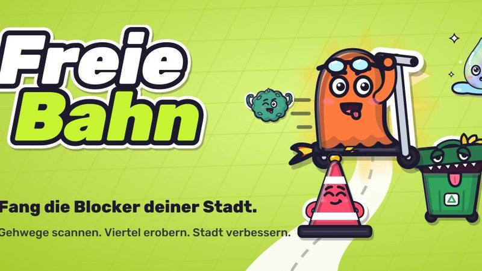
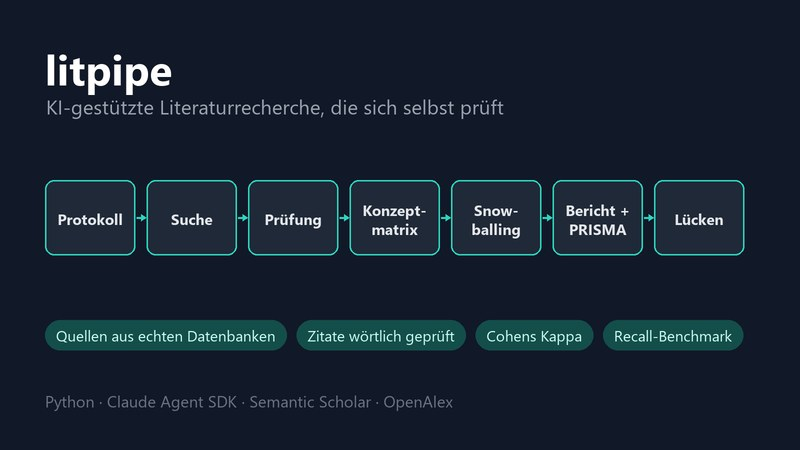
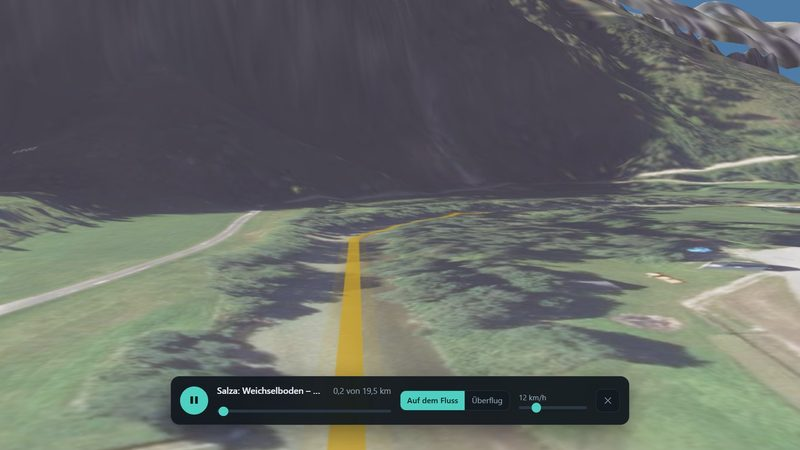
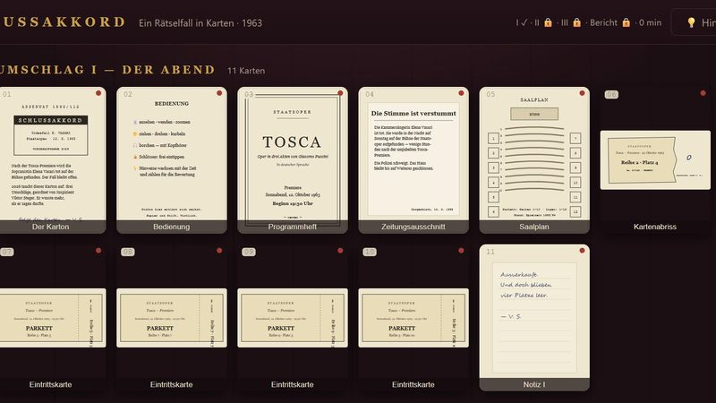
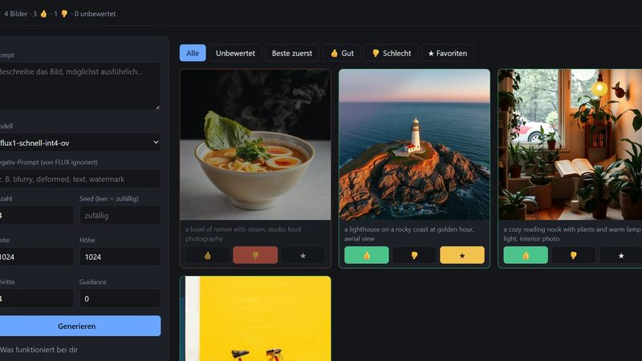
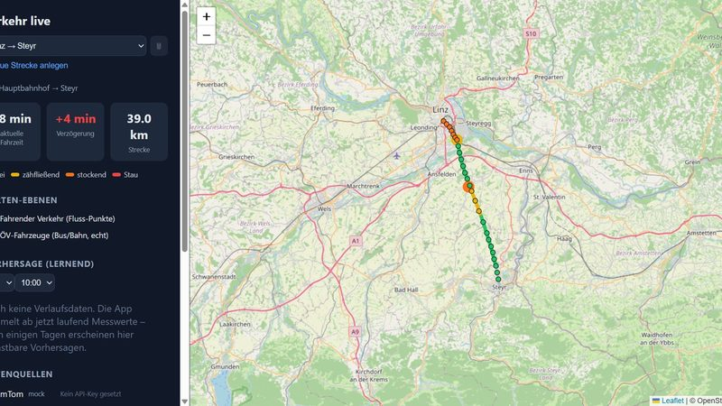
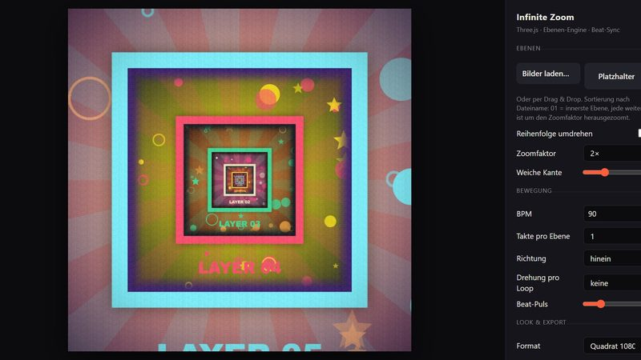

<!-- Profil-README: erscheint oben auf github.com/rasantaSanta, sobald dieses Repo als "rasantaSanta/rasantaSanta" öffentlich ist. -->
<!-- TODO vor Veröffentlichung: Name/Kontakt ergänzen (oder bewusst weglassen) und nur die Projekte stehen lassen, die öffentlich sind. -->

# Hi, ich bin rasantaSanta 👋

Ich baue Werkzeuge und Prototypen, in denen KI **nachprüfbar** mitarbeitet. Sprachmodelle planen, sortieren und
erklären, aber Regeln, echte Daten und Tests entscheiden. Meist geht es um Geodaten, Literatur und Spiele.
Hintergrund: Studium Digital Business Management, Arbeit im ERP-Umfeld.

*I build tools and prototypes where AI does real work but gets checked: LLMs plan and classify, while rules, real
data and tests decide. Mostly geodata, research tooling and games. Most projects are documented in German, each
README has an English summary.*

**Arbeitsweise:** Ich entwickle allein und nutze dabei Claude Code als Coding-Agent. Die Architektur, die Regeln
und die Abnahme liegen bei mir. Jedes README sagt offen, was getestet ist und was nicht.

## Projekte

<table>
<tr>
<td width="50%" valign="top">

<h3>Freie Bahn / GehwegScan</h3>
Handyspiel, das nebenbei die Gehwege einer Stadt kartiert. Jeder gefangene „Blocker“ wird zur Meldung an die
Gemeinde. KI im Handy anonymisiert die Fotos, die Prüfung läuft über eine Ampel aus Crowd-Labor und Server-KI, dazu
eine Lernschleife. 
Expo / React Native · React · Supabase + PostGIS · TF.js · OWLv2 · ~430 automatisierte Checks
</td>
<td width="50%" valign="top">

<h3>litpipe</h3>
KI-gestützte Literaturrecherche für systematische Reviews. Quellen nur aus echten Datenbanken, Zitate wörtlich
geprüft, Reliabilität per Cohens Kappa, Recall gegen veröffentlichte Reviews gemessen. Ausgabe als PRISMA,
Konzeptmatrix, Obsidian und Citavi. 
Python · Claude Agent SDK · Semantic Scholar · OpenAlex · scikit-learn
</td>
</tr>
<tr>
<td width="50%" valign="top">

<h3>AI City</h3>
Die Stadt Steyr als 3D-Cartoon-Welt aus freien Geodaten, bewohnt von einer simulierten Gesellschaft und
KI-Hauptfiguren. Alles Geschehen landet in einem Journal mit Hash-Kette, eine Redaktion macht daraus News und eine
Serie. 
three.js · Node · OpenStreetMap · LLM-Broker · Server-Sent Events
</td>
<td width="50%" valign="top">

<h3>Flow Europe</h3>
Flüsse in Abschnitten mit Live-Pegeln aus drei Behördenquellen und Befahrbarkeits-Ampel, dazu eine 3D-Fahrt auf dem
Fluss über Gelände aus Laserscan-Daten. 
TypeScript · MapLibre GL · Vite · GeoTIFF · PegelOnline / ehyd / HYDAVIS
</td>
</tr>
<tr>
<td width="50%" valign="top">

<h3>Riddle Games</h3>
Krimi- und Rätselspiele im Browser, ohne Framework und offline spielbar. Dazu eine eigene QA-Werkzeugkette, die
Rätsel auf Antwort-Lecks, Raten-Anfälligkeit und Eindeutigkeit prüft. 
HTML / CSS / JS · Node-QA · Headless Chrome · TTS-Pipeline
</td>
<td width="50%" valign="top">

<h3>t2i</h3>
Lokale Text-zu-Bild-KI auf einer Intel-Arc-iGPU, die aus Bewertungen lernt. Das Bewertungsmodell wird nur aktiv, wenn
ein Permutationstest zeigt, dass es besser ist als Zufall. 
Python · OpenVINO GenAI · FLUX / SDXL · FastAPI · CLIP · scikit-learn
</td>
</tr>
<tr>
<td width="50%" valign="top">

<h3>TTJ</h3>
Live-Verkehrsdashboard für eine Pendelstrecke. Es misst laufend die Fahrzeit mit und sagt daraus die beste
Abfahrtszeit je Wochentag und Stunde voraus. 
TypeScript · Express · React · Leaflet · TomTom · GTFS-Realtime
</td>
<td width="50%" valign="top">

<h3>Infinite Zoom</h3>
Endlose Zoom-Loops aus KI-Bildern, im Takt der Musik geschnitten und direkt im Browser als Video exportiert, zum
Beispiel für Spotify Canvas. 
three.js · MediaRecorder · eine HTML-Datei
</td>
</tr>
</table>

**Außerdem:** [claude-skills](https://github.com/rasantaSanta/claude-skills), zwei eigene Claude-Code-Skills für
wissenschaftliches Arbeiten (vom Stichwort zur belegten Forschungslücke, Methoden-Werkzeugkasten).

## Womit ich arbeite

**Sprachen:** TypeScript / JavaScript, Python, SQL 
**Web und 3D:** React, Vite, three.js, MapLibre GL, Leaflet, Expo / React Native 
**Backend und Daten:** Node.js, Express, FastAPI, Supabase / PostgreSQL / PostGIS, SQLite, OpenStreetMap / Overpass 
**KI:** Claude (Agent SDK, Claude Code), OpenVINO, TF.js, CLIP, OWLv2, scikit-learn 
**Arbeitsweise:** Tests und Reviews vor „fertig“, Datenschutz und Lizenzen von Anfang an mitgedacht
